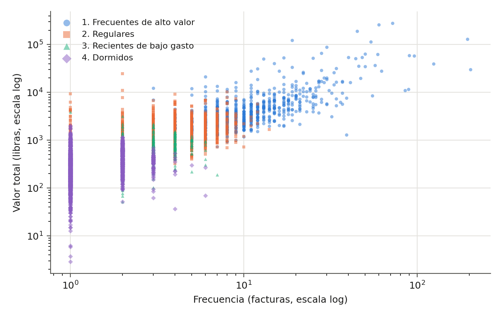
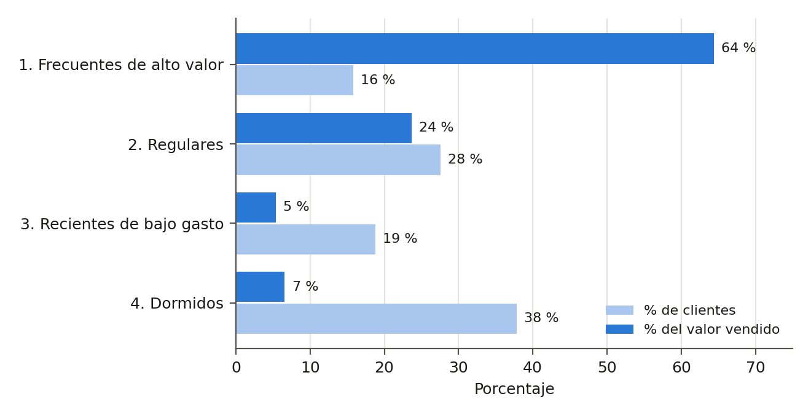

# Guía 10: minería de datos con IA

Inteligencia de Negocios, Universidad Manuela Beltrán, octubre de 2026.
Integrantes: Andrés Felipe Tabares Benavides y Kevin Santiago García.

Segmentamos a los clientes de una tienda en línea con K-means sobre su recencia, frecuencia y valor (RFM).
Los datos son reales: Online Retail, del UCI Machine Learning Repository, con las 541.909 líneas de factura
de una tienda del Reino Unido entre diciembre de 2010 y diciembre de 2011.

En este repositorio está todo lo que pide la guía como evidencia técnica: el dataset, el código, lo que imprime
al correrlo, los resultados del modelo, las gráficas y el programa de escritorio de la Fase 2.

## Qué hay en cada carpeta

| Carpeta | Contenido |
|---|---|
| `datos/` | `Online Retail.xlsx`, el archivo original sin tocar, y `preparados/clientes.csv`, la tabla de 4.324 clientes que sale de la preparación |
| `analisis/` | `mineria_clientes.py`, el código del análisis completo, fases 1 a 5 de la guía |
| `resultados/` | Bitácora de la preparación, indicadores, evaluación de k de 2 a 8, perfil de los grupos, `salida.txt` y `reporte.html` |
| `resultados/figuras/` | Las 7 gráficas del informe |
| `software/` | Segmentador de Clientes, el programa de escritorio de la Fase 2, con su código, pruebas y documentación |

## Cómo repetir el análisis

```
pip install -r requirements.txt
python analisis/mineria_clientes.py
```

Se demora unos 20 segundos. Imprime cada fase en pantalla, vuelve a generar todo lo de `resultados/` y
`datos/preparados/clientes.csv`, y abre `resultados/reporte.html` en el navegador, que tiene las tablas y las
gráficas en una sola página. Con `--sin-abrir` no abre el navegador.

En Google Colab se sube la carpeta completa y se corre con `!python analisis/mineria_clientes.py --sin-abrir`.

El resultado es siempre el mismo porque K-means usa la semilla 42. Lo que imprime está guardado en
`resultados/salida.txt`, y son las mismas cifras del informe.

## Lo que hace el código

| Fase de la guía | Qué calcula |
|---|---|
| 1. Comprensión de los datos | Tipo de cada variable, vacíos y valores distintos |
| 2. Preparación | Duplicados, cancelaciones, cantidades y precios no válidos, códigos que no son producto, descripciones y países inconsistentes, clientes faltantes, ventas anuladas, atípicos, logaritmo y estandarización. Cada paso queda anotado en `resultados/bitacora_preparacion.csv` con las filas antes y después |
| 3. Exploración | 7 indicadores y 4 gráficas: ventas por mes, productos más vendidos, frecuencia contra valor y días sin comprar |
| 4. Minería con IA | K-means sobre log(1 + x) de recencia, frecuencia y valor, estandarizados, probando de 2 a 8 grupos |
| 5. Evaluación | Silueta, Davies-Bouldin, Calinski-Harabasz, estabilidad con 10 semillas, perfil de cada grupo y un árbol de decisión que explica los grupos con reglas |

## Los cuatro grupos

| Grupo | Clientes | Días sin comprar | Facturas | Valor total (libras) | Parte de las ventas |
|---|---|---|---|---|---|
| 1. Frecuentes de alto valor | 685 | 8 | 10 | 3.692,94 | 64,4 % |
| 2. Regulares | 1.193 | 53 | 4 | 1.316,07 | 23,6 % |
| 3. Recientes de bajo gasto | 811 | 16 | 2 | 467,51 | 5,3 % |
| 4. Dormidos | 1.635 | 173 | 1 | 289,35 | 6,6 % |

Días, facturas y valor son medianas. Silueta del modelo: 0,339.





## Programa de escritorio (Fase 2)

El Segmentador de Clientes está en `software/`. Se descarga listo para usar, sin instalar nada, en la sección
**Releases** del repositorio, con una versión para Windows, otra para macOS y otra para Linux. Las instrucciones,
los diagramas y el manual están en `software/README.md` y `software/docs/DOCUMENTACION.md`.

## Fuente de los datos

Chen, D. (2015). *Online Retail* [Conjunto de datos]. UCI Machine Learning Repository.
https://doi.org/10.24432/C5BW33. Publicado con licencia CC BY 4.0.
