# Fase 2: documentación del Segmentador de Clientes

## Propósito del programa

El Segmentador de Clientes es un programa de escritorio que lleva a la práctica el modelo de minería de datos de la Fase 1. En el análisis agrupamos a los clientes de una tienda en línea del Reino Unido con K-means, usando tres variables: cuántos días llevan sin comprar (recencia), cuántas compras distintas hicieron (frecuencia) y cuánto gastaron en total (valor). El programa toma esos mismos clientes y esos mismos grupos y deja hacer con ellos lo que haría alguien de mercadeo en el día a día. Puede buscar un cliente, agregar uno nuevo y ver en qué grupo cae, corregir un dato, volver a correr K-means con otro número de grupos y mirar las gráficas, que se redibujan solas con cada cambio.

Arranca cargado con los 4.324 clientes de la tabla preparada en el análisis (`datos/preparados/clientes.csv`), que salen del conjunto Online Retail del UCI Machine Learning Repository (Chen, 2015, https://doi.org/10.24432/C5BW33). Lo hicimos así para que todo lo que muestre el programa se pueda rastrear hasta esos datos y hasta el análisis. La primera vez que abre, el programa vuelve a entrenar K-means con la misma receta y comprueba que le dan exactamente los mismos grupos del archivo. Esa comprobación queda escrita en la bitácora.

Lo escribimos en Python con piezas que se pueden revisar por separado: la ventana en Tkinter, las reglas de validación, el modelo con scikit-learn, el almacenamiento en SQLite, las gráficas en matplotlib y una autoprueba que revisa todo en el equipo donde se va a usar. Cada archivo y cada función tiene su docstring, es decir, un comentario al inicio que explica qué hace y por qué está ahí, así que la documentación del código vive junto al código.

## Cómo se ejecuta sin instalar nada

La guía pide un programa portable, sin instalación, que no sea web ni use HTML, CSS o JavaScript. Lo empaquetamos con PyInstaller en modo carpeta, que deja el ejecutable con todo lo que necesita adentro, incluido el propio Python, scikit-learn y matplotlib. Basta con descomprimir el .zip y abrir el programa. Preferimos el modo carpeta al de un solo archivo porque el de un solo archivo se descomprime en una carpeta temporal cada vez que abre, se demora más en arrancar y los antivirus lo marcan con más frecuencia.

| Sistema | Archivo en Releases (v1.0) | Cómo se abre |
|---|---|---|
| Windows 10 u 11 | SegmentadorClientes-windows.zip | Descomprimir y abrir SegmentadorClientes.exe |
| macOS | SegmentadorClientes-macos.zip | Descomprimir, clic derecho en SegmentadorClientes.app y Abrir |
| Linux | SegmentadorClientes-linux.zip | Descomprimir y ejecutar SegmentadorClientes |

Los datos quedan en segmentador_clientes.db, al lado del programa, así que si se copia la carpeta a otro equipo los datos se van con ella. Si la carpeta no deja escribir, como pasa en algunos discos protegidos, el programa guarda en la carpeta SegmentadorClientes del usuario y lo dice en la barra de abajo. El ejecutable no tiene firma comercial, entonces la primera vez Windows puede mostrar que protegió el equipo; se da clic en Más información y luego en Ejecutar de todas formas.

## Requisitos

Cada requisito tiene un identificador, lo que debe hacer el sistema y la prueba que lo comprueba. La última columna amarra cada requisito a una prueba concreta de la autoprueba o de las pruebas unitarias.

| Id | Requisito | Cómo se comprueba |
|---|---|---|
| RF01 | Cargar al abrir por primera vez los clientes del análisis con sus grupos | Autoprueba: carga los clientes del análisis con sus grupos |
| RF02 | Mostrar los clientes en una tabla con búsqueda por código o país, filtros por grupo y estado, conteo y orden por columna | Prueba unitaria de filtros y prueba de la ventana (búsqueda) |
| RF03 | Agregar, editar y eliminar clientes | Autoprueba: agrega, edita, elimina y deshace |
| RF04 | Rechazar código vacío, con símbolos o repetido y país vacío | Autoprueba: cuatro casos de rechazo |
| RF05 | Aceptar solo recencia entera desde 0, frecuencia entera desde 1 y valor mayor que 0 con coma o punto decimal | Autoprueba: rechazos de recencia, frecuencia y valor; pruebas unitarias de números |
| RF06 | Calcular solo el estado (activo hasta 90 días), el mercado y el ticket promedio | Autoprueba: estado, mercado y ticket en todos los clientes |
| RF07 | Asignar el grupo de un cliente nuevo con el modelo vigente (centroide más cercano) | Autoprueba: agrega un cliente válido y le asigna grupo |
| RF08 | Recalcular los grupos con K-means para k entre 2 y 8 y mostrar silueta, Davies-Bouldin, tamaño y medianas por grupo | Autoprueba: recalcula con k = 4, 2 y 8 y rechaza k fuera de rango |
| RF09 | Dibujar cinco gráficas y redibujarlas con cada cambio; exportarlas a PNG o PDF | Autoprueba: genera las cinco gráficas y un PDF |
| RF10 | Importar CSV con coma o punto y coma y exportar CSV para Excel | Autoprueba: CSV de ida y vuelta, CSV con coma y CSV con errores |
| RF11 | Guardar una bitácora de cambios, deshacer y restaurar los datos del análisis | Autoprueba: bitácora y restauración |
| RNF01 | Ejecutarse sin instalación en Windows, macOS y Linux | Autoprueba sobre el ejecutable empaquetado en los tres sistemas |
| RNF02 | Mostrar cada error en español claro, sin cerrar la ventana | Prueba de la ventana con un valor inválido |
| RNF03 | Conservar los datos al cerrar y volver a abrir | Prueba de persistencia en disco |
| RNF04 | Reproducir los grupos del análisis con la misma receta | Autoprueba: recalcular con k = 4 reproduce exactamente los grupos del análisis |

## Arquitectura

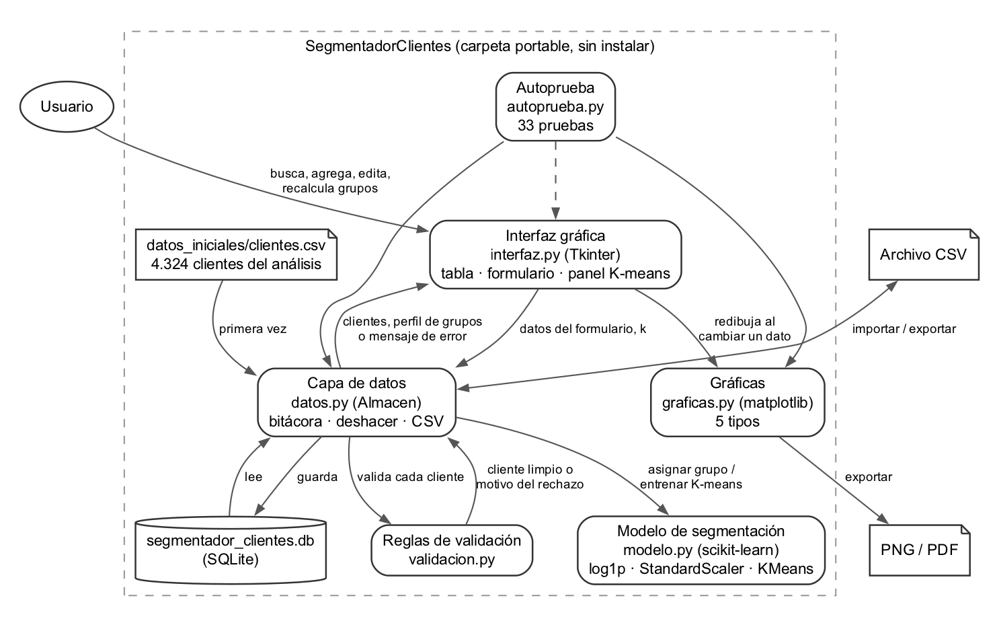

La regla principal fue que cada decisión viva en un solo sitio. La ventana no valida nada: le pasa a la capa de datos lo que escribió el usuario y la capa de datos le devuelve el cliente guardado o el motivo del rechazo, que se muestra tal cual en rojo debajo del formulario. Las reglas de validación están en validacion.py y las usan igual el formulario, la importación de CSV y la carga inicial. El modelo K-means está en modelo.py, separado de la base, para que la misma función que entrena en el programa sea la que se prueba en las pruebas unitarias.

Escogimos Python porque Tkinter y SQLite vienen incluidos, scikit-learn es la librería con la que hicimos el análisis y matplotlib exporta a PNG y PDF con la misma función que dibuja en pantalla. Usar la misma librería del análisis no fue un detalle menor: es lo que permite que el programa dé exactamente los mismos grupos que el informe.

## Módulos y funciones principales

| Módulo | Funciones principales | Qué hace |
|---|---|---|
| app.py | main() | Lee los argumentos: abre la ventana, corre la autoprueba o usa otra base |
| validacion.py | validar_cliente(), validar_codigo(), validar_pais(), validar_entero(), validar_valor(), leer_decimal(), estado_de(), mercado_de() | Reglas de cada campo y cálculo de estado, mercado y ticket |
| modelo.py | entrenar(), desde_grupos(), nombrar(), perfil(), validar_k(); clase Modelo con asignar() y estandarizar() | K-means, renumeración, nombres de los grupos y asignación de clientes nuevos |
| datos.py | clase Almacen: clientes(), agregar(), actualizar(), eliminar(), recalcular(), deshacer(), restaurar_originales(), importar_csv(), exportar_csv(), diferencias_con_originales(); leer_csv() | Base SQLite, bitácora con reversa de cada cambio, carga inicial y CSV |
| graficas.py | dibujar(), exportar(), ubicar(); grupos(), dispersion(), participacion(), recencia(), paises() | Las cinco gráficas, con el mismo color y marcador por grupo en todas |
| interfaz.py | clase Aplicacion: refrescar(), llenar_tabla(), llenar_perfil(), redibujar(), guardar(), recalcular(), ver_bitacora() | La ventana: tabla, formulario, gráfica y panel de K-means |
| formato.py | numero(), libras() | Números con punto de miles y coma decimal |
| autoprueba.py | ejecutar() | 33 pruebas sin intervención y reporte.txt |

## Modelo de datos

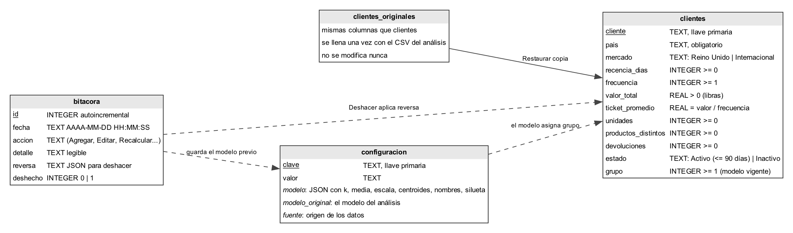

La base tiene cuatro tablas. En clientes está lo que se ve en la tabla del programa, con restricciones CHECK que repiten en la base las reglas más importantes, por ejemplo frecuencia mayor o igual a 1 y valor mayor que 0, para que ni siquiera un error de programación pueda guardar un dato imposible. La tabla clientes_originales se llena una sola vez con el CSV del análisis y no se vuelve a tocar; sirve para restaurar y para mostrar qué cambió. En configuracion se guarda el modelo vigente en JSON (k, media y desviación de cada variable, centroides, nombres, silueta y Davies-Bouldin) y una copia del modelo original. En bitacora cada cambio queda con la fecha, la acción, un detalle legible y la reversa, que es lo mínimo necesario para deshacerlo: para un cliente agregado basta su código, para uno editado o eliminado se guarda la fila anterior y para un recálculo se guardan los grupos y el modelo anteriores.

## Diagrama de clases

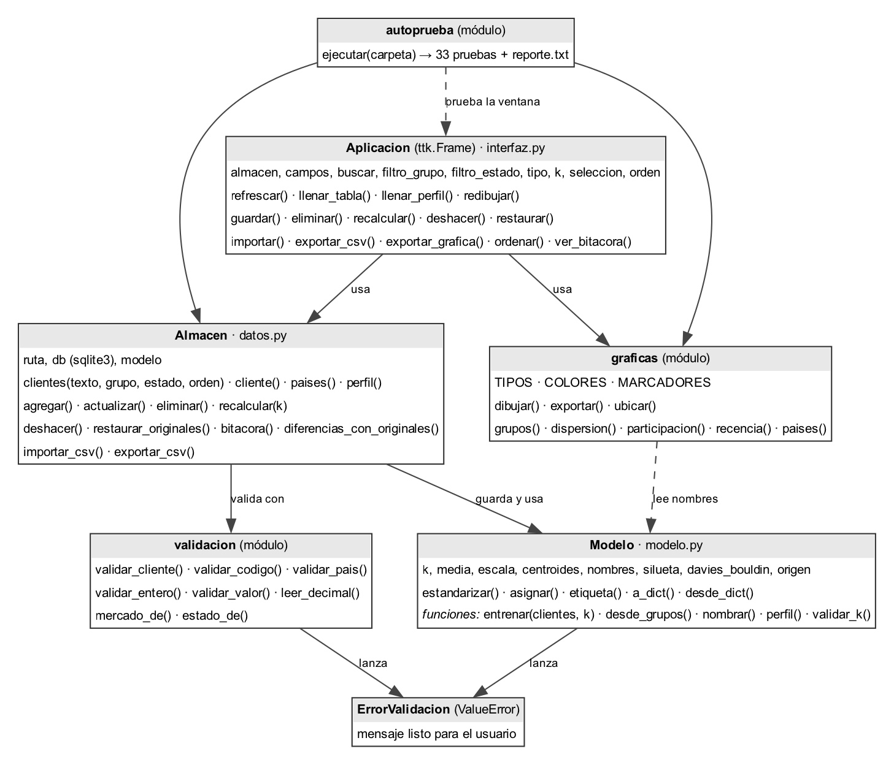

## Reglas de validación

Un dato es completo si trae todos los campos obligatorios, válido si cada campo cumple su regla y consistente si no choca con lo que ya está guardado. Estas son las reglas, en el orden en que se revisan; el primer error que aparece es el que se muestra.

| Campo | Regla | Mensaje que ve el usuario (ejemplo) |
|---|---|---|
| Código del cliente | Obligatorio; letras, números o guiones; máximo 20 caracteres; no puede existir ya | Ya existe el cliente 12347 (Iceland). Selecciónelo en la tabla para editarlo. |
| País | Obligatorio, máximo 40 caracteres, no puede ser un número. Si coincide sin tildes ni mayúsculas con uno guardado, se usa el guardado | Escriba el país del cliente. |
| Recencia (días) | Entero entre 0 y 3.650 | La recencia debe ser un número entero mayor o igual a 0; recibí -3. |
| Frecuencia (compras) | Entero desde 1 | La frecuencia debe ser un número entero mayor o igual a 1; recibí 0. |
| Valor total (libras) | Número mayor que 0, con coma o punto decimal (1250,50 o 1.250,50 o 1250.50); se guarda con dos decimales | El valor total debe ser un número, por ejemplo 1250,50; recibí mil. |
| Unidades, productos distintos y devoluciones | Opcionales, enteros desde 0; los productos distintos no pueden ser más que las unidades | Los productos distintos (9) no pueden ser más que las unidades compradas (3). |

Lo que no se digita lo calcula el programa: el estado es Activo si la recencia es de 90 días o menos e Inactivo si es mayor; el mercado es Reino Unido o Internacional según el país; el ticket promedio es el valor total dividido por la frecuencia; y el grupo lo asigna el modelo K-means vigente. La importación de CSV usa exactamente las mismas reglas y es de todo o nada: si una sola fila falla, no se importa ninguna y el mensaje dice la línea y el motivo.

## Procedimiento K-means

El programa usa la misma receta del análisis, paso por paso:

1. Para cada cliente toma log(1 + recencia), log(1 + frecuencia) y log(1 + valor total). El logaritmo baja el peso de los pocos clientes que compran muchísimo, que de otro modo arrastrarían los centroides.
2. Estandariza las tres variables (StandardScaler): a cada una le resta su media y la divide por su desviación, para que ninguna domine la distancia solo por estar en otra escala.
3. Corre KMeans con k grupos, 20 inicios distintos (n_init = 20) y semilla fija (random_state = 42). De los 20 inicios se queda con el de menor inercia, y la semilla hace que el resultado sea el mismo cada vez.
4. Renumera los grupos por valor total medio, de mayor a menor. Así el grupo 1 es siempre el de más valor y los números no cambian de una corrida a otra.
5. Calcula la silueta (de -1 a 1, más alta quiere decir grupos mejor separados) y el índice de Davies-Bouldin (más bajo es mejor) con scikit-learn.
6. Pone nombres solo si k = 4 y el perfil de verdad coincide con el del análisis: el grupo 1 debe tener la frecuencia mediana más alta, y de los dos grupos de menor valor el 4 debe llevar más de 90 días sin comprar y el 3 noventa o menos. Si no se cumple, o si k es otro, los grupos se llaman Grupo 1, Grupo 2 y así. No queríamos que un nombre como Dormidos quedara pegado a un grupo que ya no lo es.

Con los 4.324 clientes del análisis y k = 4 el programa obtiene:

| Grupo | Clientes | % de clientes | % del valor | Recencia mediana | Frecuencia mediana | Valor mediano |
|---|---|---|---|---|---|---|
| 1. Frecuentes de alto valor | 685 | 15,8 % | 64,4 % | 8 días | 10 | £ 3.692,94 |
| 2. Regulares | 1.193 | 27,6 % | 23,6 % | 53 días | 4 | £ 1.316,07 |
| 3. Recientes de bajo gasto | 811 | 18,8 % | 5,3 % | 16 días | 2 | £ 467,51 |
| 4. Dormidos | 1.635 | 37,8 % | 6,6 % | 173 días | 1 | £ 289,35 |

La silueta es 0,339 y el índice de Davies-Bouldin 1,012, los mismos valores del análisis, y los 4.324 clientes quedan cada uno en el mismo grupo que trae el archivo. En el análisis k = 2 tenía mejor silueta (0,434), pero solo partía a los clientes en buenos y malos; con cuatro grupos aparecen perfiles con los que mercadeo sí puede hacer algo distinto, y la silueta baja poco. El programa deja probar cualquier k entre 2 y 8 para que esa decisión se pueda revisar.

Para un cliente nuevo el programa no vuelve a entrenar. Toma sus tres variables, las transforma con el logaritmo y con la media y la desviación guardadas en el modelo, y lo pone en el grupo cuyo centroide está más cerca. Es lo que haría el modelo entrenado con un cliente que no conocía, y evita que un solo cliente nuevo mueva a otros. Volver a entrenar es una decisión aparte, con el botón Recalcular grupos, y queda en la bitácora.

## Diagrama de flujo principal

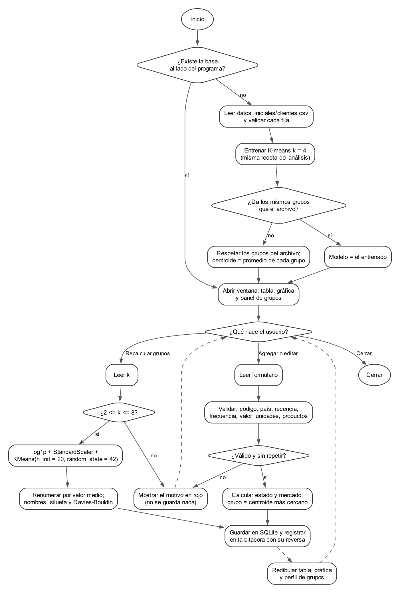

El diagrama recorre lo que pasa desde que se abre el programa: la carga inicial con la comprobación de que K-means reproduce los grupos del análisis, y después los dos caminos principales, agregar o editar un cliente y recalcular los grupos. Los dos terminan igual, guardando en SQLite con su registro en la bitácora y redibujando la tabla, la gráfica y el perfil de los grupos.

Los dos algoritmos centrales quedaron también en pseudocódigo de PSeInt, que genera su propio diagrama de flujo con la opción Dibujar diagrama de flujo:

- agregar_cliente.psc: lee el modelo vigente y los datos de un cliente, aplica las reglas de validación en el mismo orden que el programa, calcula estado, mercado y ticket, y asigna el grupo por el centroide más cercano.
- recalcular_grupos.psc: lee los clientes y k, calcula los logaritmos, estandariza, corre K-means con 20 inicios aleatorios quedándose con el de menor inercia y renumera los grupos por valor medio con un ordenamiento burbuja.

## Las gráficas y por qué cada una

| Gráfica | Para qué sirve |
|---|---|
| Clientes por grupo | Ver el tamaño de cada grupo, con la cantidad y el porcentaje encima de cada barra |
| Frecuencia vs valor total | Ver cómo separa el modelo a los clientes. Ejes logarítmicos porque hay clientes de 1 compra y de más de 200. Cada grupo tiene un color y una forma de marcador distintos, para que se distingan también impresas en blanco y negro o por alguien que no distingue colores |
| Participación en el valor | Comparar qué parte del dinero aporta cada grupo frente a qué parte de los clientes tiene. Es la que mejor cuenta el hallazgo: el grupo 1 tiene el 15,8 % de los clientes y aporta el 64,4 % del valor |
| Histograma de recencia | Ver cuánto tiempo llevan los clientes sin comprar. La línea de 90 días separa activos (2.876, el 66,5 %) de inactivos (1.448, el 33,5 %) |
| Top 10 países por valor | Ver de dónde viene el dinero. El Reino Unido concentra el 82,3 % del valor; la escala es lineal para no exagerar a los países pequeños |

Las gráficas usan siempre todos los clientes. Los filtros de la tabla sirven para buscar, no para cambiar las gráficas, porque una gráfica de grupos dibujada solo con los inactivos daría una idea equivocada del modelo. Los colores de los grupos son siempre los mismos en las cinco gráficas, en la tabla de perfil y en los reportes: azul para el 1, naranja para el 2, verde para el 3 y morado para el 4.

## Manual de usuario

**1. Pantalla principal.** Al abrir el programa aparecen a la izquierda la tabla de clientes, el formulario y los botones de datos, y a la derecha la gráfica y el panel de grupos. La barra de abajo dice dónde se están guardando los datos.

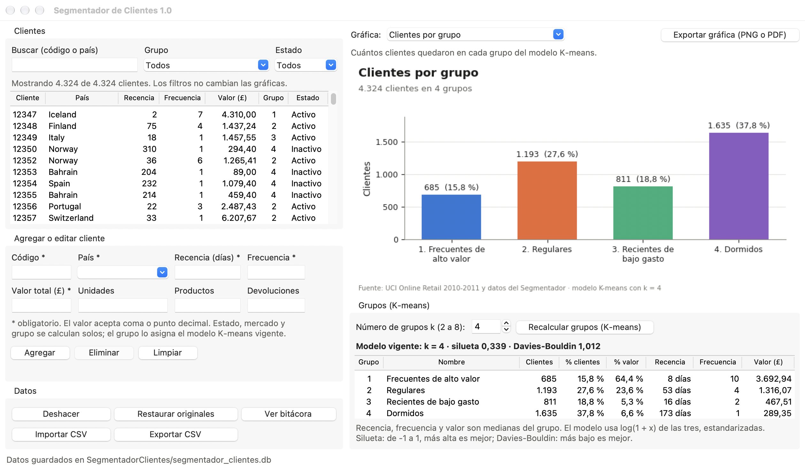

**2. Cambiar de gráfica.** En la lista Gráfica, arriba a la derecha, se escoge cualquiera de las cinco. Debajo del selector el programa explica para qué sirve y debajo del título escribe la lectura principal. El botón Exportar gráfica guarda la que esté en pantalla en PNG o en PDF.

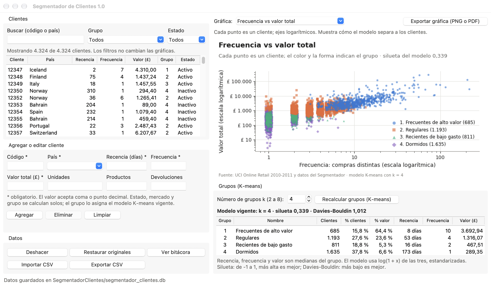

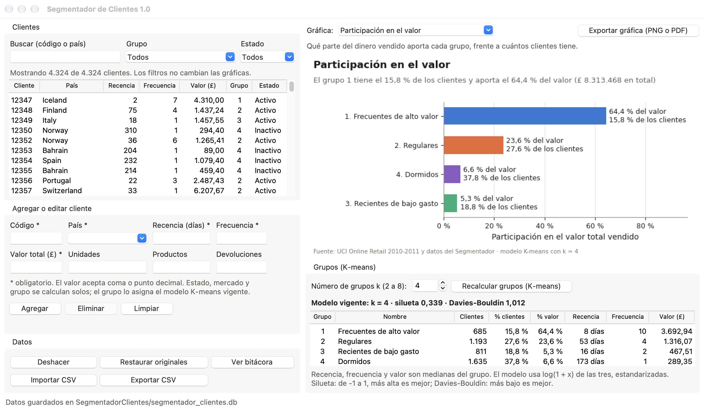

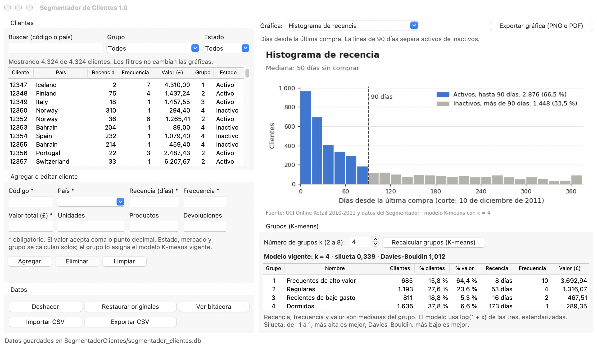

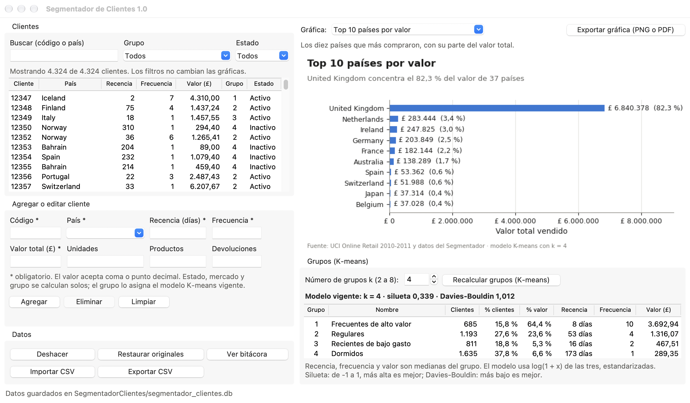

**3. Recalcular los grupos.** En el panel Grupos (K-means) se escribe k, entre 2 y 8, y se da clic en Recalcular grupos. El programa corre K-means, actualiza la tabla de perfil, el número de grupo de cada cliente y la gráfica, y escribe en la barra de abajo la silueta y el índice de Davies-Bouldin. En la Figura 10 recalculamos con k = 4 sobre los datos originales y salieron los mismos grupos del análisis.

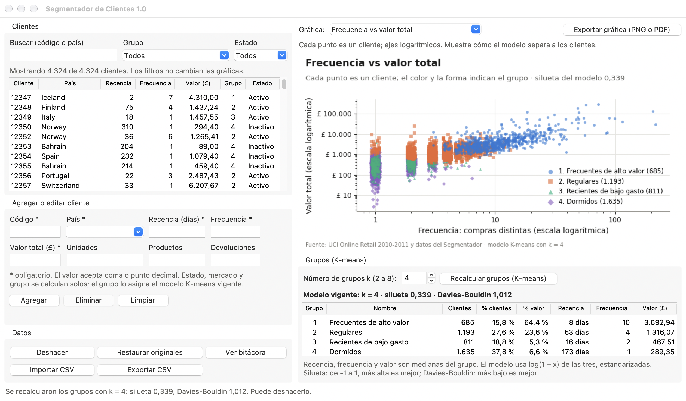

**4. Agregar un cliente.** Se llenan los campos del formulario (los que tienen asterisco son obligatorios) y se da clic en Agregar o Enter. Si algún dato no cumple una regla no se guarda nada y el motivo sale en rojo. En la Figura 11 intentamos agregar un cliente con frecuencia 0.

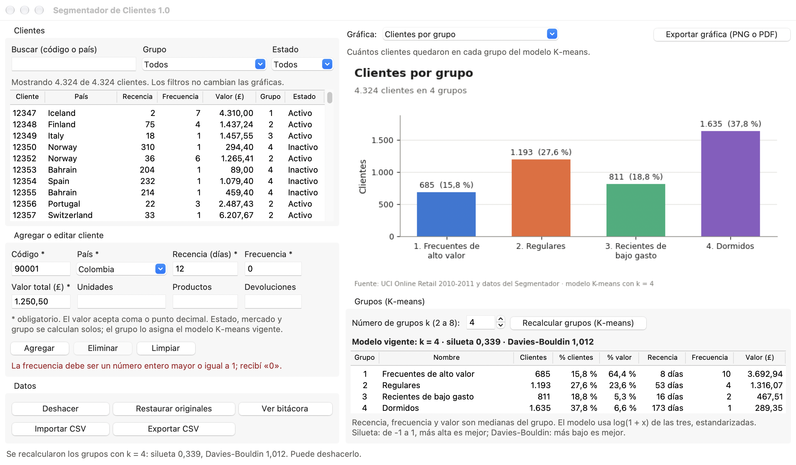

Con la frecuencia corregida a 6 el cliente se guardó, y la barra de abajo dice en qué grupo quedó, en este caso 2. Regulares, y si quedó activo o inactivo. Para editar un cliente basta con hacer clic en su fila: el formulario se llena solo, el código queda bloqueado y el botón cambia a Guardar cambios. Al guardar, el grupo se vuelve a asignar con el modelo vigente.

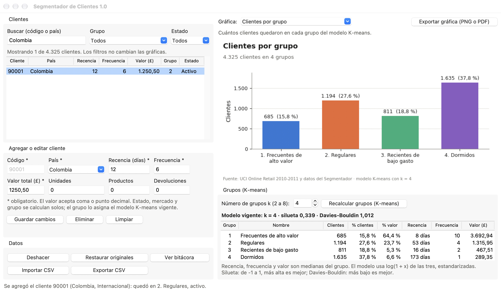

**5. Buscar y filtrar.** El cuadro Buscar encuentra por código o por país, sin importar tildes ni mayúsculas. Las listas Grupo y Estado filtran la tabla, y un clic en cualquier encabezado la ordena por esa columna; un segundo clic invierte el orden. En la Figura 13 se ven los clientes Regulares inactivos ordenados por valor de mayor a menor, que serían los primeros a los que habría que llamar.

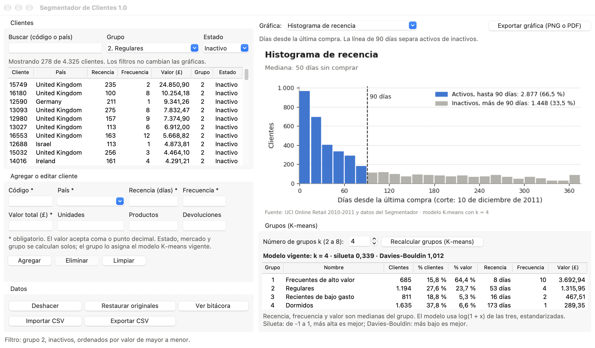

**6. Probar otro número de grupos.** Con k = 5 la silueta baja a 0,316 y los grupos pierden los nombres, porque el perfil ya no corresponde a los cuatro del análisis.

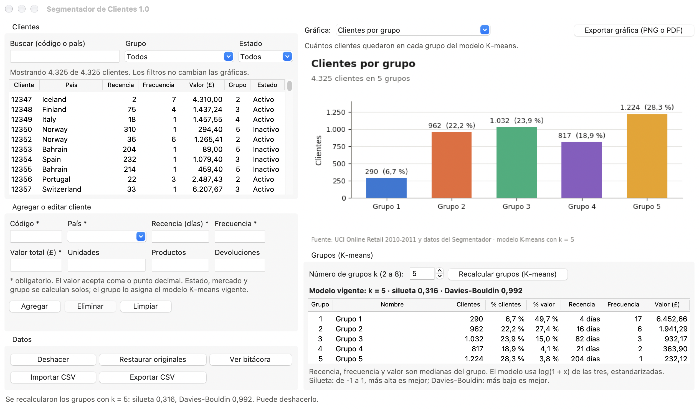

**7. Deshacer, restaurar y bitácora.** Deshacer, o Control Z, devuelve el último cambio, sea un cliente agregado, una edición o un recálculo completo. Restaurar originales vuelve a los clientes y al modelo del análisis sin borrar el historial. Ver bitácora muestra la fuente de los datos, las diferencias frente al análisis y todos los cambios con su fecha.

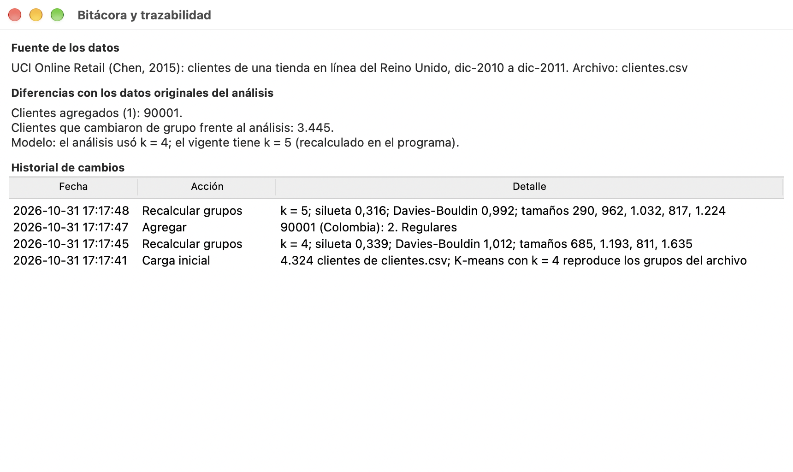

**8. Importar y exportar.** Exportar CSV guarda todos los clientes con su grupo y el nombre del grupo, separados por punto y coma y con coma decimal, para que Excel los abra bien en un equipo en español. Importar CSV acepta archivos separados por coma o por punto y coma con encabezado; las columnas obligatorias son cliente, pais, recencia_dias, frecuencia y valor_total. Los grupos de los clientes importados los asigna el modelo vigente.

## Pruebas y resultados

Probamos en tres niveles. Las 38 pruebas unitarias revisan por separado las reglas de validación, la base de datos (carga, persistencia, deshacer, restaurar, CSV) y el modelo (renumeración, nombres, asignación al centroide más cercano, métricas y gráficas). Usan un archivo sintético de 120 clientes en cuatro grupos bien separados, fixture_clientes.csv, que existe solo para las pruebas.

La autoprueba va dentro del mismo programa y se corre con SegmentadorClientes --autoprueba seguido de una carpeta. Hace 33 pruebas sobre una copia temporal de los datos reales, sin tocar los del usuario: valida la carga inicial, comprueba que recalcular con k = 4 reproduce los grupos del análisis cliente por cliente, agrega, edita, elimina, prueba diez datos inválidos con su mensaje esperado, recalcula con k = 2, 4 y 8, deshace, restaura, hace CSV de ida y vuelta, genera las cinco gráficas, abre la ventana real y usa el formulario, la búsqueda y el panel de K-means. Deja reporte.txt y las gráficas en la carpeta.

El tercer nivel es la compilación automática en GitHub Actions. En cada push empaqueta el programa en Windows, macOS y Linux, corre las pruebas unitarias y la autoprueba desde el código y luego corre la autoprueba otra vez sobre el ejecutable ya empaquetado, que es lo que de verdad se va a abrir en la sala. El reporte de cada sistema queda guardado en la corrida.

| Dónde corrió | Qué se probó | Resultado |
|---|---|---|
| Mac con macOS 27, código fuente | 38 pruebas unitarias | 38 de 38 |
| Mac con macOS 27, código fuente | Autoprueba | 33 de 33 |
| Mac con macOS 27, ejecutable empaquetado con PyInstaller | Autoprueba, con ventana | 33 de 33 |
| GitHub Actions: Windows, macOS y Ubuntu Linux | Pruebas unitarias, autoprueba del código y del ejecutable | Se corre en cada push; el reporte queda en la corrida |

Durante el desarrollo salieron fallas reales. Las dejamos anotadas con su corrección, porque varias no se habrían visto sin las pruebas.

| Falla encontrada | Corrección |
|---|---|
| El ejecutable empaquetado no exportaba a PDF: faltaba el módulo de PDF de matplotlib, aunque desde el código la misma prueba pasaba | Importamos ese módulo de forma explícita para que PyInstaller lo incluya; la autoprueba del ejecutable lo detectó |
| El primer empaquetado pesaba 597 MB porque PyInstaller recogió librerías que no usamos y que estaban instaladas en el equipo | Empaquetamos desde un entorno virtual limpio con solo requirements.txt, como hace GitHub Actions; quedó en 122 MB |
| En el histograma, los clientes con 90 días exactos caían en la barra de inactivos | Los bordes de las barras quedaron en 90,5 días, así el día 90 cuenta como activo, igual que en la regla |
| En una pantalla de portátil de 1.280 puntos la tabla del panel K-means y la explicación de la gráfica quedaban cortadas | Angostamos el formulario y la tabla, y las métricas pasaron a su propia línea |
| Con la ventana pequeña el título de la gráfica se montaba sobre el subtítulo | Los márgenes se calculan en puntos y no en proporciones, y se recalculan al cambiar el tamaño de la ventana |
| La gráfica de países en escala logarítmica hacía ver a los países pequeños casi tan grandes como el Reino Unido | Pasamos a escala lineal con el valor y el porcentaje escritos en cada barra |
| En la gráfica de participación, la etiqueta de la barra más larga se salía por el borde derecho | Cada etiqueta quedó en dos líneas y el eje se ajustó; lo vimos al revisar las capturas |
| Una prueba esperaba un ticket promedio de 250,13 y el programa daba 250,12 | Estaba mal la prueba: 1.000,50 entre 4 es 250,125, que el computador no puede guardar exacto en binario, y al redondear queda 250,12. Cambiamos el caso por uno exacto |

## Cómo se compila

```
pip install -r requirements.txt "pyinstaller>=6.16"
python -m unittest discover -s pruebas
python app.py --autoprueba salida
pyinstaller --noconfirm --clean --onedir --windowed --collect-submodules numpy._core \
  --add-data "segmentador/datos_iniciales/clientes.csv:segmentador/datos_iniciales" \
  --name SegmentadorClientes app.py
```

En Windows el separador de --add-data es punto y coma en vez de dos puntos. La opción --add-data mete dentro del ejecutable el CSV con los clientes del análisis, que es una copia de datos/preparados/clientes.csv, y --collect-submodules numpy._core evita un error que ya nos pasó en la Guía 9, cuando el ejecutable no abría por un módulo interno de numpy que PyInstaller no recogía solo. El flujo completo está en .github/workflows/compilar.yml, en la raíz del repositorio.

## Límites conocidos

K-means es sensible a los datos con que se entrena. En la autoprueba, después de agregar y editar un solo cliente, recalcular con k = 4 dejó grupos de 687, 1.194, 811 y 1.633 clientes en vez de 685, 1.193, 811 y 1.635, y 4.319 de los 4.325 clientes siguieron en su grupo. Los que se mueven son los que están en la frontera entre dos grupos. Por eso un cliente nuevo se asigna con el modelo vigente y recalcular es una decisión aparte que queda en la bitácora.

La recencia de un cliente nuevo debe medirse desde la misma fecha de corte del análisis, el 10 de diciembre de 2011, para que sea comparable con la de los demás. Los nombres de los países quedan en inglés, como vienen en la fuente. Los nombres de los grupos solo aparecen con k = 4 y cuando el perfil coincide. Los datos viven en el equipo donde está la carpeta y no en la nube, lo que le sirve a la portabilidad, pero para compartirlos toca pasar la carpeta completa o exportar el CSV. El ejecutable no tiene firma digital comercial, así que Windows y macOS muestran una advertencia la primera vez.
